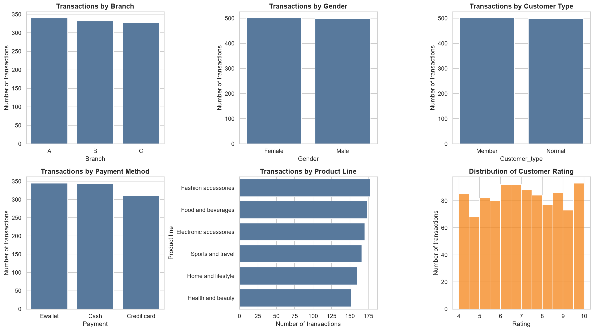
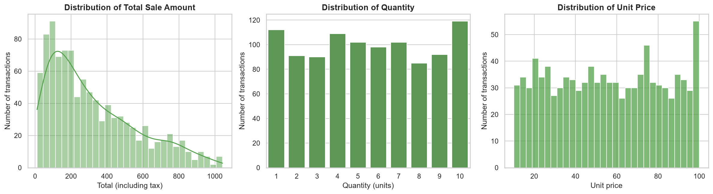
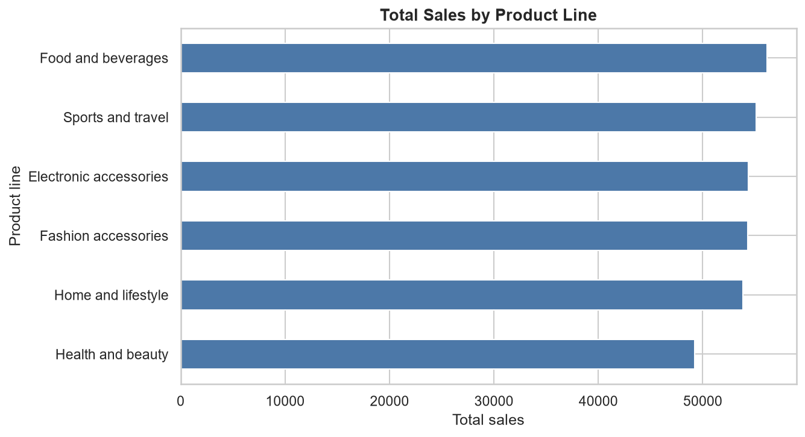
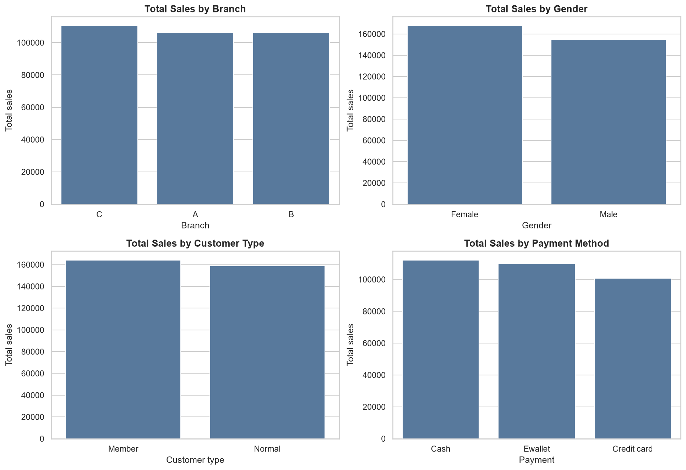
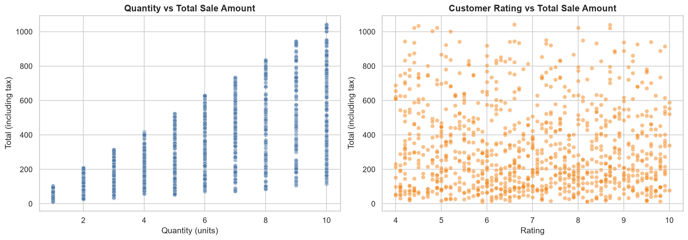
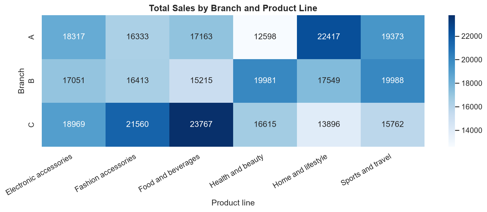
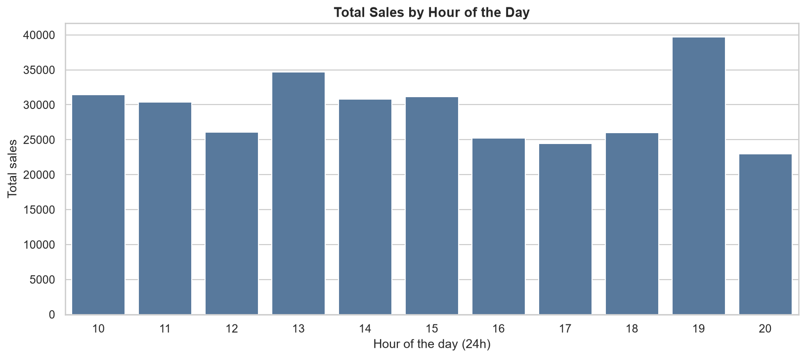
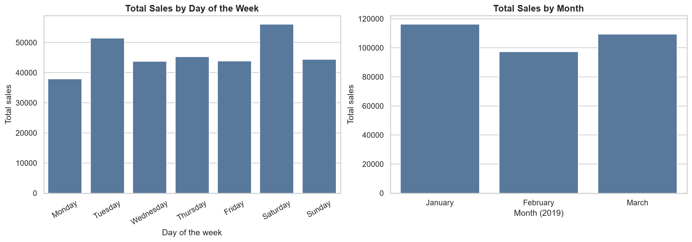
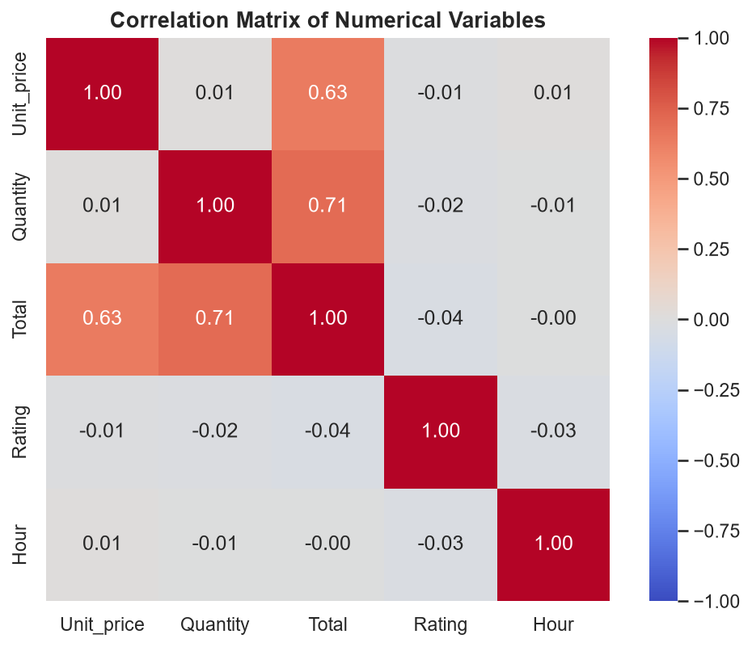
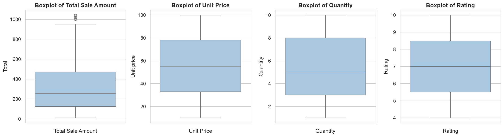

# Supermarket Sales — Exploratory Data Analysis

### Overview
This is a beginner-friendly Exploratory Data Analysis (EDA) project built with Python. It analyzes supermarket sales transactions to understand which branches, product lines, payment methods and time periods are associated with higher sales.

The project is **EDA only** — no machine learning is used.

### Dataset
- **Source:** a supermarket sales dataset (CSV) with **1,000 invoices** and **17 columns**.
- **Period:** 1 January 2019 – 30 March 2019 (89 days).
- **Branches:** A (Yangon), B (Mandalay), C (Naypyitaw).
- **Main columns:** `Invoice ID`, `Branch`, `City`, `Customer type`, `Gender`, `Product line`, `Unit price`, `Quantity`, `Tax 5%`, `Total`, `Date`, `Time`, `Payment`, `cogs`, `gross margin percentage`, `gross income`, `Rating`.
- **Data quality:** no missing values and no duplicate rows.
- **Notes found during the analysis:** `gross income` is identical to `Tax 5%`, `gross margin percentage` is a constant (4.76%), and `Branch` maps one-to-one to `City`. Because of this, the dataset cannot be used to measure real profit.

### Objectives
- Check data quality and prepare the data for analysis.
- Understand the distribution of the main variables.
- Compare sales across branches, product lines, customer types, genders and payment methods.
- Find the busiest sales periods (hour, day of week, month).
- Study correlations and outliers carefully, without claiming causation.
- Summarize practical business insights from the data.

### Technologies Used
- Python
- Pandas
- NumPy
- Matplotlib
- Seaborn
- Jupyter Notebook

### Project Workflow
1. Project introduction
2. Import libraries
3. Load and inspect the dataset
4. Data cleaning (rename columns, convert `Date`/`Time`, check nulls and duplicates)
5. Feature understanding and time-based features (`Hour`, `Day_of_week`, `Month`)
6. Univariate analysis
7. Bivariate analysis
8. Time analysis
9. Correlation analysis
10. Outlier analysis
11. Business questions
12. Key business insights
13. Conclusion

### Exploratory Analysis
- **Univariate:** countplots for categories, histograms for `Total`, `Unit price`, `Rating`.
- **Bivariate:** sales by product line, branch, gender, customer type and payment; quantity vs total; rating vs total; branch × product-line heatmap.
- **Time:** sales by hour, weekday and month (with average daily sales, because February is shorter).
- **Correlation:** heatmap of `Unit_price`, `Quantity`, `Total`, `Rating`, `Hour`.
- **Outliers:** boxplots and the IQR rule. Outliers were **kept** because they are legitimate large purchases.

### Key Insights
All numbers below were calculated in the notebook.

1. **Branch C has the highest sales** (110,569, 34.2% of the total) vs A (106,200) and B (106,198) — a small gap of about 4%.
2. **Food and beverages is the top product line** (56,145); **Health and beauty is the lowest** (49,194).
3. **Each branch has a different best-selling product line:** A — Home and lifestyle, B — Sports and travel, C — Food and beverages.
4. **Peak periods:** 19:00 is the busiest hour (39,700 in sales) and Saturday is the strongest day (56,121). Monday is the weakest (37,899).
5. **Female customers have a higher average invoice** (335.10 vs 310.79) with almost the same number of transactions.
6. **Members spend only slightly more than Normal customers** (164,223 vs 158,743 in total).
7. **Cash (112,207) and Ewallet (109,993) lead the payment methods;** Credit card is the least used (311 transactions).
8. **Rating is not related to sale amount** (correlation ≈ -0.04).
9. **9 high-value invoices are outliers** (about 1,002–1,043). Each has quantity = 10 and a unit price of about 95–99, so they are real purchases, not errors.

### Visualizations

| | |
|---|---|
|  |  |
|  |  |
|  |  |
|  |  |
|  |  |

### Conclusion
The dataset is clean and balanced. The three branches and six product lines perform similarly overall, but they differ in their product mix. Sales peak in the evening and on Saturdays, and the sale amount is mainly driven by quantity and unit price. Customer rating is not related to the amount spent.

**Limitations:** only 3 months and 1,000 invoices, so seasonality cannot be studied; profit cannot be measured from the margin columns.

**Possible future work:** test whether differences between groups are statistically significant, study what drives customer ratings, and use real cost data to analyze profit.

### How to Run
```bash
# 1. Clone the repository
git clone https://github.com/<your-username>/supermarket-sales-eda.git
cd supermarket-sales-eda

# 2. (Optional) create a virtual environment
python -m venv venv
source venv/bin/activate        # Windows: venv\Scripts\activate

# 3. Install the requirements
pip install -r requirements.txt

# 4. Start Jupyter and open the notebook
jupyter notebook notebooks/supermarket_sales_eda.ipynb
```
Run the notebook from the `notebooks/` folder, because the data path is `../data/supermarket_sales.csv`.

### Requirements
```
pandas
numpy
matplotlib
seaborn
jupyter
```
